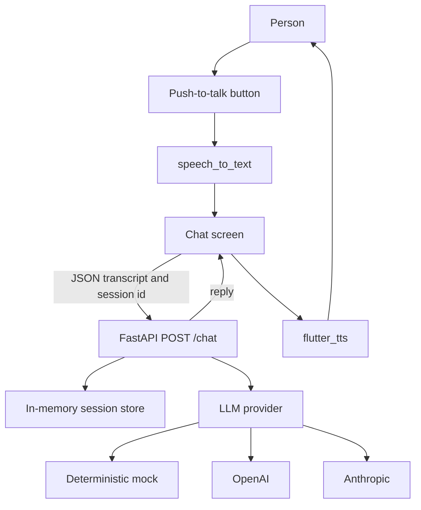

# Mobile AI Voice Companion

A small, working portfolio project by Martin Couso: a Flutter phone app with push-to-talk speech, and a FastAPI service you can run locally or deploy to Google Cloud Run.

You hold the microphone button, the phone turns speech into text, the API continues that conversation, and the phone reads the reply aloud. You can also type. The API defaults to a deterministic mock model, so the whole loop runs with no API keys.

This is version 1. It is not a published product, and this repository does not claim users, downloads, or uptime.

## Architecture



The Flutter app is the client. `speech_to_text` fills a transcript while the mic button is held. On release, the app `POST`s that text to `/chat` with a session id. The API appends the turn to that session, calls the configured provider, stores the reply, and returns it. `flutter_tts` speaks the reply when that option is on.

The provider is chosen with `LLM_PROVIDER`:

| Value | Behavior |
| --- | --- |
| `mock` (default) | Deterministic replies. No network call and no key. |
| `openai` | Chat Completions HTTP API. Requires `OPENAI_API_KEY`. |
| `anthropic` | Messages HTTP API. Requires `ANTHROPIC_API_KEY`. |

Session memory is a process-local dictionary. It is there so a conversation can refer to earlier turns. It is not a database. Cloud Run can start more than one instance, and instances are replaced, so a later request can land somewhere that has never seen that session. Treat v1 memory as a single-process demo. The roadmap covers a shared store.

## Repository layout

```text
app/        Flutter client (Android and iOS)
backend/    FastAPI service and Dockerfile
infra/      Terraform for Cloud Run, plus a gcloud script
```

## Quickstart: API

Python 3.11 or newer.

```bash
cd backend
python3 -m venv .venv
source .venv/bin/activate
pip install -r requirements.txt
cp .env.example .env
uvicorn app.main:app --host 0.0.0.0 --port 8080
```

Check it:

```bash
curl -s http://127.0.0.1:8080/health
curl -s http://127.0.0.1:8080/chat \
  -H 'content-type: application/json' \
  -d '{"message":"Hello"}'
```

Send the returned `session_id` on the next call. `DELETE /sessions/{session_id}` drops that session.

`--host 0.0.0.0` lets a phone on the same network reach the process. Binding to localhost is enough for an emulator only when you use the emulator's host alias (below).

## Quickstart: app

Flutter 3.47.9 (the version CI installs). Android Studio or Xcode for a device or emulator.

```bash
cd app
flutter pub get
flutter run --dart-define=BACKEND_URL=http://10.0.2.2:8080
```

`10.0.2.2` is the Android emulator's alias for the computer running the API. An iOS simulator should use `http://127.0.0.1:8080`. A physical phone should use the computer's LAN address, for example `http://192.168.1.20:8080`, with the API listening on `0.0.0.0`.

The backend URL can also be changed from the settings sheet in the app. That value is stored on the device with `shared_preferences` and overrides the `--dart-define` default on the next launch.

Hold the round microphone button to talk, then release it to send. The text field sends a message without the microphone. Speech recognition uses the platform recognizer (Android `SpeechRecognizer`, iOS speech framework). A desktop host or an emulator image without a recognizer will not be able to dictate; typing still talks to the API. The app asks for the microphone and, on iOS, speech-recognition permission.

"New conversation" clears the screen and deletes that session on the server when the server can be reached.

## Configuration

Copy `backend/.env.example` to `backend/.env`. That file has no secrets. Real keys stay in the environment or in Secret Manager, not in git.

| Variable | Default | Purpose |
| --- | --- | --- |
| `LLM_PROVIDER` | `mock` | `mock`, `openai`, or `anthropic` |
| `OPENAI_API_KEY` | empty | Required only for `openai` |
| `OPENAI_MODEL` | `gpt-4o-mini` | Model id your OpenAI account can call |
| `OPENAI_BASE_URL` | `https://api.openai.com/v1` | Override for a compatible endpoint |
| `ANTHROPIC_API_KEY` | empty | Required only for `anthropic` |
| `ANTHROPIC_MODEL` | `claude-3-5-haiku-latest` | Model id your Anthropic account can call |
| `ANTHROPIC_BASE_URL` | `https://api.anthropic.com` | API host |
| `MAX_HISTORY_TURNS` | `20` | Stored messages per session (2–200) |
| `CORS_ORIGINS` | `*` | Browser origins. The mobile app does not use CORS |

The app's compile-time default is `BACKEND_URL` (`http://10.0.2.2:8080` if unset).

Model ids above are defaults, not a promise that every account still serves those names. Change them to a model your key can call. The mock provider ignores them.

The system prompt asks for a short spoken reply. It also says the assistant is not a clinician or an emergency service. The mock provider does not follow that prompt as a language model would; it returns fixed sentences, including one that quotes earlier user text when you ask what you said.

## Tests

Backend, from `backend/` with the dev requirements installed:

```bash
ruff check .
ruff format --check .
pytest
```

App, from `app/`:

```bash
flutter analyze
flutter test
```

Widget and unit tests use fake speech, fake speech synthesis, and a fake HTTP client. They do not call a microphone or a hosted model.

Terraform, from `infra/`:

```bash
terraform fmt -check -recursive
terraform init -backend=false
terraform validate
```

GitHub Actions (`.github/workflows/ci.yml`) runs those three jobs.

## Deployment

CI does not deploy anything, and this repo does not contain cloud credentials.

The API image is `backend/Dockerfile`. It listens on `$PORT`, which Cloud Run sets. `infra/README.md` has the Terraform apply order and a manual `infra/deploy.sh` path. Read that before creating resources: both paths are billable, and a public Cloud Run service with a paid model key will accept traffic from anyone who has the URL.

`allow_unauthenticated` defaults to false. API keys are Secret Manager secret ids, not Terraform values. `terraform.tfvars` is gitignored. The example tfvars file has placeholders only.

## Roadmap

- Store sessions in something shared (Firestore or Memorystore) so Cloud Run scaling does not split a conversation.
- Stream tokens and start speaking before the full reply is done.
- Put authentication on `/chat` before any paid provider is exposed.
- A hands-free mode that does not need the button held down.
- Clearer handling when the device has no speech recognizer.
- Release packaging for Play and the App Store, including signing, which this v1 does not set up.

## License

MIT. Copyright (c) 2026 Martin Couso. See [LICENSE](LICENSE).
